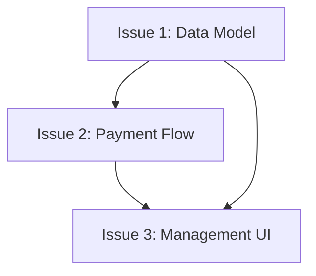
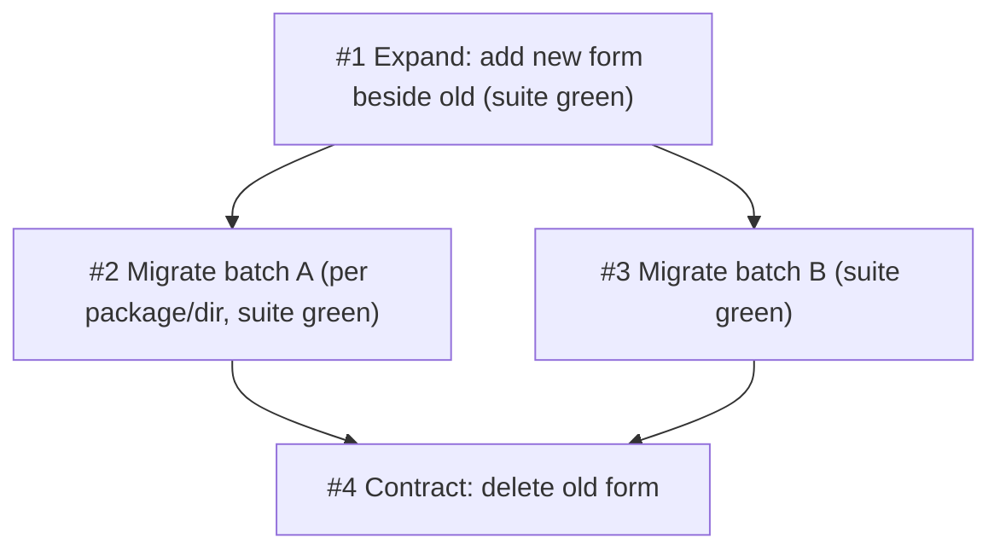

# Story: Detailed Reference

## Issue Template

The Issue body format (title, Meta, Parent, What to build, Acceptance Criteria, Blocked by, field rules) is defined once in [STORY-FORMAT.md](STORY-FORMAT.md) — that file is the single source, used by both `/think` (parent issues) and `/story` (child issues). Do not retype it here.

**Do not close any parent issue** — appending the child-issues list to its body (Step 9) is the designed sync and the only allowed modification.

## Process Detail

### Step 0: Read Project Configuration

Apply the [Skill Entry Protocol](../rules/entry-protocol.md) to locate CONTEXT.md, ADR paths, and determine multi-repo scope. Read `docs/agents/issue-tracker.md` and `docs/agents/triage-labels.md`.

If neither `domain.md` nor `repo-map.md` exists, use default paths (`CONTEXT.md`, `docs/prd/`, `docs/adr/`).

If `repo-map.md` exists and indicates issues should be created in a different repo, note this for Step 6.

### Step 1: Determine Input Source

Check what input the user provided:

1. **Existing PRD** — user mentions a feature name with an existing PRD file at `docs/prd/PRD-NNNN-<title>.md`, or says "break this PRD into issues"
2. **Existing issue** — user references an existing issue number as the parent, and that issue points to a PRD
3. **Direct description or issue without a PRD** — stop. Explain that a frozen PRD is required and route to `think` → `grill`. For a small, clear change, recommend direct implementation instead of creating a ticket workflow.

**PRD Issue field detection:** When an existing PRD is found, read its `## Issue` section. Three cases:

- **`#<number>` present** → this is the parent issue — use it as the parent reference when creating child issues in Step 7 (Publish Issues), and update it in Step 9 (Sync Issue). Do not ask the user for the parent if it's already recorded in the PRD.
- **`N/A — no issue tracker configured`** → `/think` Step 10a waived the parent (repo has no tracker). Create child issues with no parent reference; skip Step 9.
- **Field empty/missing** → no parent reference needed; treat as standalone child issues.

If a PRD exists, proceed to Step 2. If no PRD exists, there is nothing valid to slice.

### Step 2: Extract Requirements & Quality Check

**Baseline Consistency Gate (blocking):** When reading an existing PRD, verify the full gate in `SKILL.md`. At minimum:

| Signal | Meaning | Action |
|--------|---------|--------|
| PRD has `Open Questions` / `TODO` / `?` markers | Decisions unresolved | Stop; return to `grill` |
| Requirements or acceptance criteria lack stable `R#` / `AC#` IDs | Coverage cannot be checked reliably | Add IDs as a labeling-only Change Log entry, then re-read |
| A requirement has no acceptance criterion | Not independently verifiable | Stop; return to `grill` |
| A criterion has no requirement or non-functional label | Untraceable scope | Stop; return to `grill` |
| Criteria or `Out of Scope` contradict each other | Baseline is internally inconsistent | Stop; return to `grill`, or `think` if the goal changed |
| `CONTEXT.md` does not exist | No domain glossary | Note the gap; continue only when terminology is unambiguous |
| `docs/adr/` is empty or missing | No architecture decisions recorded | Note the gap; flag significant design decisions in issues |

Missing `CONTEXT.md` or ADRs alone does not block slicing; unresolved requirements, untraceable criteria, or contradictions do.

**When input is an existing PRD:**

Read `docs/prd/PRD-NNNN-<title>.md` file, understand complete requirements. After reading, check the `Issue` field for a parent issue number (e.g., `#42`). If present, use it as the parent reference when creating child issues. If absent, no parent reference needed.

Do not fill missing requirements from the issue description or a verbal summary. The PRD is the contract.

### Step 3: Ensure PRD Exists

If PRD already exists at `docs/prd/PRD-NNNN-<title>.md`: skip this step.

If no PRD exists, stop. Do not create a "minimal PRD" here: an un-grilled PRD is not a frozen baseline. Route the user to `think` → `grill`, then return to `story`.

### Step 4: Explore Codebase (Optional)

If codebase not yet explored, do so to understand current state. Issue titles and descriptions should use project's domain glossary vocabulary and respect ADRs in areas you're touching.

### Step 5: Draft Vertical Slices

Break plan into **tracer bullet** issues. Each issue is a **thin vertical slice** that goes through all integration layers end-to-end, **not** a horizontal slice of one layer.

For every slice, fill `Covers` with the parent PRD requirement and acceptance-criterion IDs it closes. Build a coverage map before presenting:

- every PRD acceptance criterion is assigned to at least one slice;
- a criterion shared by multiple slices states why;
- no slice exists without a parent requirement or a stated enabling/refactor reason.

Slices may be 'HITL' or 'AFK':
- **HITL** slices require human interaction at some point (architecture decisions, design reviews, UX choices). Marked for the human's project planning.
- **AFK** slices can be implemented end-to-end without human interaction. Suitable for autonomous agent execution.

**Vertical slice rules:**
- Each slice traces one narrow but **complete** path through every affected layer
- Completed slice is demonstrable or verifiable on its own
- Prefer many thin slices over few thick slices

### Step 6: Present to User

Present proposed breakdown as numbered list. For each slice, show:

- **Title**: Short descriptive name
- **Type**: HITL / AFK
- **Blocked by**: Other slices that must complete first (if any)
- **Covers**: Which PRD requirements and acceptance criteria this slice closes

Before presenting, self-check the draft against these quality questions — granularity (too coarse / too fine), dependencies and cycles, merge/split candidates, HITL/AFK markings, and acceptance-criterion coverage — and fix what you find. State `Coverage: <assigned>/<total>`. Then ask exactly one question: **"Approve this breakdown, or adjust which part?"** (with your recommendation: approve). If the user names an adjustment, revise and ask again — one decision per message (anti-patterns #3, #4).

### Step 7: Write Approved List and Publish Issues

After approval, first write the approved slice list to the PRD's `## Traceability → Sliced into` section using stable local slice IDs (`S1`, `S2`, ...) and set `Status: Sliced`. This local write is the source of truth if remote publishing fails. Then continue with publishing.

Read `docs/agents/issue-tracker.md` for the issue creation convention (GitHub `gh`, GitLab `glab`, Gitee MCP/OpenAPI, or local markdown). Read `docs/agents/triage-labels.md` for the label mapping. Preserve string Issue numbers and full URLs; Gitee parent/dependency references follow its configured convention, not GitHub-only APIs.

**Multi-repo:** If `repo-map.md` indicates issues should be created in a different repo, use that repo's issue tracker. Add `cross-repo` label (if configured) to issues touching multiple repos.

**Issue title format**: `[PRD-NNNN] <vertical-slice-description> — <core-behavior>`. Use the same language as the user's input language; ask when unsure.

For each approved slice, publish new issue to tracker. Use issue body template above. The `Meta` section must include:
- **PRD**: Full PRD file path (PRD-NNNN-<title>.md)
- **Type**: AFK or HITL
- **Covers**: Parent PRD requirement and acceptance-criterion IDs
- **Siblings**: Other child issues from the same PRD (if any)

If not otherwise indicated, these issues are considered ready for AFK agents, so publish with correct triage labels.

Publish issues in dependency order (blockers first) so you can reference real issue identifiers in "Blocked by" fields.

### Step 8: Replace Local IDs with Tracker IDs

**Issue title format**: `[PRD-NNNN] <vertical-slice-description> — <core-behavior>`

Replace the local slice IDs with the actual tracker identifiers, preserving each slice's type, `Covers`, blockers and status:

```markdown
- **Sliced into**:
  - #<issue-1> — [PRD-NNNN] <slice title> (AFK) — covers: R1, AC1 — Dev Complete
  - #<issue-2> — [PRD-NNNN] <slice title> (HITL, blocked by #<issue-1>) — covers: R2, AC2 — In Progress
  - #<issue-3> — [PRD-NNNN] <slice title> (AFK) — covers: R3, AC3 — not started
```

**Status markers**:
- `— Dev Complete` — code implemented, compiled, committed and pushed; page testing not yet passed
- `— Accepted` — the declared page-testing scope passed
- `— Done` — accepted, reviewed when requested, and closed/merged
- `— In Progress` — Issue being implemented
- No marker — Issue not started

Fill the `Sliced by` field in the PRD's `## Traceability` section:

```markdown
- **Sliced by**: `/story` → Child Issues above
```

### Step 9: Sync Issue (if exists)

If parent Issue exists, update its body to include child issues list.

## Horizontal vs Vertical Slices

**WRONG (Horizontal):**
```
Issue 1: All database schemas
Issue 2: All API endpoints
Issue 3: All UI components
```
- No issue is independently verifiable
- Cannot demo until all complete
- High coordination risk

**RIGHT (Vertical):**
```
Issue 1: Subscription schema + CRUD API + compile verification
Issue 2: Payment flow + webhook handling + compile verification
Issue 3: Management UI + page acceptance
```
- Each issue is verifiable independently
- Can demo after each issue
- Lower coordination risk

## Slice Thickness

**Too thick:**
- "Build entire subscription system" (contains multiple features)

**Just right:**
- "Create subscription data model"
- "Implement payment processing"
- "Build management UI"

**Too thin:**
- "Create subscription table"
- "Add subscription API endpoint"
- "Add one assertion" (micro-fragments, overhead dominates)

## Dependencies



In this example:
- Issue 2 is blocked by Issue 1 (needs data model)
- Issue 3 is blocked by both Issue 1 and Issue 2 (needs model + payment flow)

Publish in order: A → B → C, so A's issue number is available when referencing from B and C.

## Wide Refactors: the Expand → Migrate → Contract Sequence

When the change is one mechanical edit with codebase-wide blast radius (rename a shared column, retype a shared symbol), a vertical slice cannot land green alone — every touched call site breaks in the same edit. Sequence it instead:



- **Expand** (1 ticket): add the new column/symbol/form beside the old one, nothing migrates. Suite stays green because both forms exist.
- **Migrate** (N tickets, each blocked by Expand): move call sites over in batches sized by blast radius — per package or per directory. Each batch lands green because the old form still serves the unmigrated majority.
- **Contract** (1 ticket, blocked by every Migrate): delete the old form once no caller remains. Suite green proves completeness.

If even a batch can't stay green alone, keep the sequence but let the batch tickets share an integration branch; green is promised only at the batch boundary.
