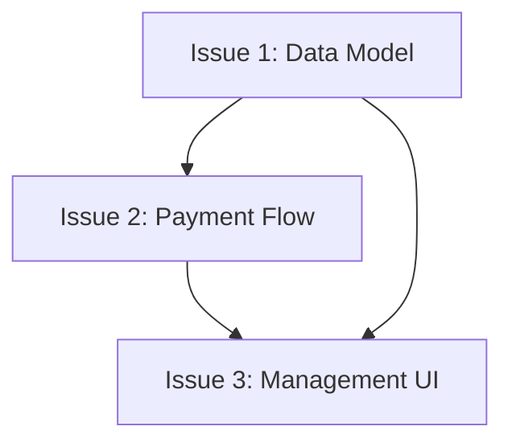
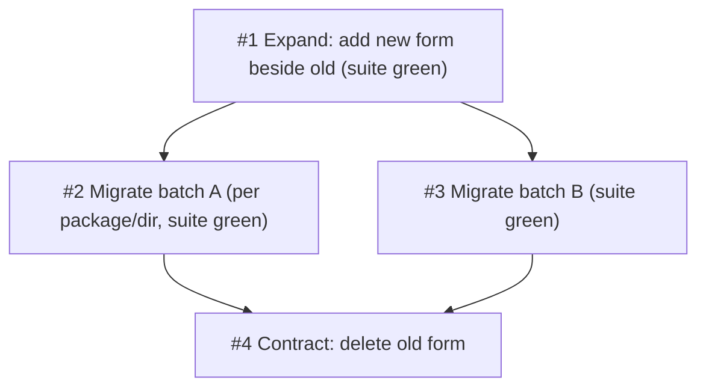

# Story: Detailed Reference

## Optional Issue Template

When the project already has an Issue tracker and the current request authorizes publishing, the body format (title, Meta, Parent, What to build, Acceptance Criteria, Blocked by, field rules) is defined once in [STORY-FORMAT.md](STORY-FORMAT.md). It is not required for conversational slicing.

If an existing parent Issue is in scope, do not close it merely because slicing completed. Synchronizing its body is the only allowed modification unless the user requests more.

## Process Detail

### Step 0: Read Project Configuration

Apply the [Skill Entry Protocol](../rules/entry-protocol.md) selectively to locate only the requirements, decisions, and repository context relevant to this plan. Read tracker configuration only if the task will publish Issues.

If neither `domain.md` nor `repo-map.md` exists, use default paths (`CONTEXT.md`, `docs/prd/`, `docs/adr/`).

If `repo-map.md` exists and the task will publish Issues to a different repository, note this for Step 6.

### Step 1: Determine Input Source

Check what input the user provided:

1. **Existing requirement record** — an existing PRD or project specification owns the feature
2. **Direct description** — user describes a feature or asks to break down an approved plan
3. **Existing issue** — user references an existing issue number as the parent

**PRD Issue field detection:** When an existing PRD is found, read its `## Issue` section. Three cases:

- **`#<number>` present** → this is the parent issue — use it as the parent reference when creating child issues in Step 7 (Publish Issues), and update it in Step 9 (Sync Issue). Do not ask the user for the parent if it's already recorded in the PRD.
- **`N/A — no issue tracker configured`** → no parent existed when the plan was recorded. If publishing is later authorized, create child issues with no parent reference; otherwise skip Issue publishing and Step 9.
- **Field empty/missing** → no parent reference needed; treat as standalone child issues.

If a PRD exists, skip to Step 5 (Draft Vertical Slices).

If no PRD exists and the user gave a direct description, proceed to Step 2 to extract requirements.

### Step 2: Extract Requirements & Quality Check

**Quality check (degradation handling):** When reading an existing requirement record, check whether decisions needed for slicing are unresolved:

| Signal | Meaning | Action |
|--------|---------|--------|
| Requirement record has `Open Questions` / `TODO` / `?` markers | Decisions unresolved | Resolve the ones that block slicing; note the rest without requiring a separate stage. |
| No glossary exists | No maintained domain glossary | Proceed silently. Use the project's existing terms. |
| No ADR directory exists | No architecture decision records | Proceed silently. Do not create one merely for slicing. |

If unresolved decisions block a demonstrable slice, return to requirement or design clarification. Missing glossary, ADRs, or a formal validation marker is not a blocker.

**When input is a direct description (no PRD):**

1. Parse the user's description for:
   - What to build (goal)
   - Key requirements (explicitly stated or implied)
   - Any mentioned constraints or preferences
2. Explore the codebase to fill gaps:
   - What exists already (models, APIs, services related to the feature)
   - Project conventions (patterns, naming, testing style)
   - Check `CONTEXT.md` for domain glossary, `docs/adr/` for relevant decisions
3. Ask focused clarification questions only for genuinely ambiguous points that affect slicing. Do NOT run a full brainstorming session; return to requirement clarification if the goal or acceptance criteria are missing.
4. Compile findings into a requirements list.

**When input is an existing PRD:**

Read `docs/prd/PRD-NNNN-<title>.md` file, understand complete requirements. After reading, check the `Issue` field for a parent issue number (e.g., `#42`). If present, use it as the parent reference when creating child issues. If absent, no parent reference needed.

**Minimal requirements to proceed:**
- Goal (what this feature does)
- At least 2 requirements
- At least 1 acceptance criterion

If these cannot be extracted, return to requirement clarification; the feature is too underspecified for direct slicing.

### Step 3: Use the Existing Requirement Source

If a PRD or project specification already owns this requirement, use it. Do not create a PRD solely to hold slices.

If the user explicitly wants a durable PRD and none exists, run the **PRD Conflict Check** before creating one; the full procedure lives in [think/REFERENCE.md §PRD Conflict Check](../think/REFERENCE.md#prd-conflict-check-before-assigning-nnnn).

If no collision (or the user chose a new PRD), create a minimal PRD containing only real information — do not leave empty headings. Use these sections:

| Section | Source |
|---------|--------|
| `Goal` | From the user's description |
| `Requirements` | Extracted in Step 2 |
| `Acceptance Criteria` | Derived from requirements |
| `Out of Scope` | If the user mentioned boundaries |
| `Technical Notes` | Findings from codebase exploration |
| `Traceability` | Add `- **Created by**: slicing stage (`story`, minimal PRD, no requirement-stage `think` pass)` — child issues later land in its `Sliced into` list (Step 8) |

Sections like Research References, Feasible Approaches, Decision (ADR-lite), and Implementation Plan belong to requirement and design work; do not add them merely to hold a slice list.

Write the file. Step 8 may record slices there when the project uses PRDs.

### Step 4: Explore Codebase (Optional)

If codebase not yet explored, do so to understand current state. Issue titles and descriptions should use project's domain glossary vocabulary and respect ADRs in areas you're touching.

### Step 5: Draft Vertical Slices

Break the plan into **tracer bullet** slices. Each is a **thin vertical slice** through the layers the behavior actually needs end-to-end, **not** a horizontal slice of one layer.

Slices may be 'HITL' or 'AFK':
- **HITL** slices require human interaction at some point (architecture decisions, design reviews, UX choices). Marked for the human's project planning.
- **AFK** slices can be implemented end-to-end without human interaction. Suitable for autonomous agent execution.

**Vertical slice rules:**
- Each slice traces one narrow but **complete** path through the layers it actually changes; tests are included only when the current request requires them
- Completed slice is demonstrable or verifiable on its own
- Prefer many thin slices over few thick slices

### Step 6: Present to User

Present proposed breakdown as numbered list. For each slice, show:

- **Title**: Short descriptive name
- **Type**: HITL / AFK
- **Blocked by**: Other slices that must complete first (if any)
- **User stories covered**: Which user stories this solves (if source material has them)

Before presenting, self-check the draft for granularity (too coarse / too fine), dependencies, merge/split candidates, and HITL/AFK markings. Then ask for approval with a recommended breakdown; revise only the parts the user changes.

### Step 7: Publish Issues (Optional)

Publish only when the project already has a tracker and the current request authorizes external writes. Read its convention and labels at that point. Otherwise keep the approved list in the existing plan record or conversation.

**Multi-repo:** If `repo-map.md` indicates issues should be created in a different repo, use that repo's issue tracker. Add `cross-repo` label (if configured) to issues touching multiple repos.

**Issue title format**: `[PRD-NNNN] <vertical-slice-description> — <core-behavior>`. Use the same language as the user's input language; ask when unsure.

If publishing, for each approved slice use the issue body template. The `Meta` section includes:
- **PRD**: Full PRD file path (PRD-NNNN-<title>.md)
- **Type**: AFK or HITL
- **Siblings**: Other child issues from the same PRD (if any)

If not otherwise indicated, these issues are considered ready for AFK agents, so publish with correct triage labels.

Publish issues in dependency order (blockers first) so you can reference real issue identifiers in "Blocked by" fields.

### Step 8: Record the Slices

**Issue title format**: `[PRD-NNNN] <vertical-slice-description> — <core-behavior>`

When a PRD is in use, add its slice list and dependencies to the appropriate traceability section:

```markdown
- **Sliced into**:
  - #<issue-1> — [PRD-NNNN] <slice title> (AFK) — Done
  - #<issue-2> — [PRD-NNNN] <slice title> (HITL, blocked by #<issue-1>) — In Progress
  - #<issue-3> — [PRD-NNNN] <slice title> (AFK)
```

**Status markers**:
- `— Done` — Issue closed and code merged
- `— In Progress` — Issue being implemented
- No marker — Issue not started

If the project uses the traceability fields, fill `Sliced by`:

```markdown
- **Sliced by**: slicing stage (`story`) → Child Issues above
```

### Step 9: Sync an Existing Issue (Optional)

Only if an existing parent Issue is already in scope and tracker writes are authorized, update its body with the approved slice list.

## Horizontal vs Vertical Slices

**WRONG (Horizontal):**
```
Issue 1: All database schemas
Issue 2: All API endpoints
Issue 3: All UI components
```
- No issue is independently verifiable
- Cannot demo until all complete
- High coordination risk

**RIGHT (Vertical):**
```
Issue 1: Subscription schema + CRUD API
Issue 2: Payment flow + webhook handling
Issue 3: Management UI
```
- Each issue is verifiable independently
- Can demo after each issue
- Lower coordination risk

## Slice Thickness

**Too thick:**
- "Build entire subscription system" (contains multiple features)

**Just right:**
- "Create subscription data model"
- "Implement payment processing"
- "Build management UI"

**Too thin:**
- "Create subscription table"
- "Add subscription API endpoint"
- "Write subscription test" (micro-fragments, overhead dominates)

## Dependencies



In this example:
- Issue 2 is blocked by Issue 1 (needs data model)
- Issue 3 is blocked by both Issue 1 and Issue 2 (needs model + payment flow)

Publish in order: A → B → C, so A's issue number is available when referencing from B and C.

## Wide Refactors: the Expand → Migrate → Contract Sequence

When the change is one mechanical edit with codebase-wide blast radius (rename a shared column, retype a shared symbol), a vertical slice cannot land green alone — every touched call site breaks in the same edit. Sequence it instead:



- **Expand** (1 ticket): add the new column/symbol/form beside the old one, nothing migrates. Suite stays green because both forms exist.
- **Migrate** (N tickets, each blocked by Expand): move call sites over in batches sized by blast radius — per package or per directory. Each batch lands green because the old form still serves the unmigrated majority.
- **Contract** (1 ticket, blocked by every Migrate): delete the old form once no caller remains. Suite green proves completeness.

If even a batch can't stay green alone, keep the sequence but let the batch tickets share an integration branch; green is promised only at the batch boundary.
